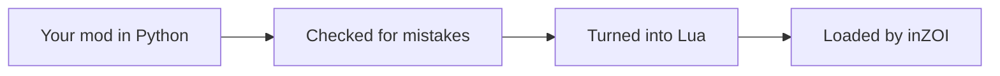

<div align="center">

# inzoi.py

**Write your inZOI mods in Python.**<br>
inzoi.py turns them into the Lua the game understands.

[](https://www.python.org/)
[](#roadmap)
[](LICENSE)

[](#quick-look)
[](#how-it-works)
[](#roadmap)
[](#development)

*Early days: the plan is done, the code isn't. None of the examples below work yet.*

</div>

<div align="center">

## Why inzoi.py?

**Mods read the way you think about the game.**<br>
A Zoi is an `inzoi.Zoi`, ten minutes are `inzoi.Minutes(10)`, and coins are coins.

**Mistakes show up early.**<br>
Mix up experience points and money, and inzoi.py tells you what went wrong and how to fix it,
long before the game sees your mod.

**Nothing extra in the game.**<br>
What ends up in inZOI is small, plain Lua, just like a mod written by hand.

**Try things out without starting the game.**<br>
You can test your mod's logic right on your computer.

</div>

<div align="center">

## Quick look

This is roughly how a mod will look. A few names may still change.

</div>

```python
import inzoi

class FishCoin(inzoi.Currency, name='FishCoin'):
    """The coins anglers earn at the lake."""

class FishingPro(inzoi.Mod, version=inzoi.Version(0, 1, 0), author='YourName'):
    """Rewards Zois while they hang out at a lake."""

    @inzoi.condition()
    def is_at_lake(self, interaction: inzoi.Interaction) -> bool:
        """Only offers the lake interactions while the Zoi is at a lake."""
        return interaction.zoi.site == inzoi.Site.LAKE

    @inzoi.execute()
    def grant_reward(self, interaction: inzoi.Interaction, buff: inzoi.Buff, coins: FishCoin = FishCoin(0)) -> None:
        """Gives the target a buff and pays the Zoi in fish coins."""
        interaction.target.add_buff(buff, inzoi.Minutes(10))
        interaction.zoi.earn(coins)
        print(f'Granted {coins} coins')
```

<details>
<summary>Show the Lua that inzoi.py makes from this</summary>

```lua
function IsAtLake(ctx, param)
    return inzoi.GetSiteType(ctx.self) == "Lake"
end

function GrantReward(ctx, param)
    local buff = tostring(param.S2)
    local coins = param.F1 or 0
    inzoi.AddBuff(ctx.target, buff, 600)
    inzoi.AddCurrency(ctx.self, "FishCoin", coins)
    inzoi.log("[FishingPro] Granted " .. tostring(coins) .. " coins")
end
```

`inzoi.Minutes(10)` simply becomes `600`, and `inzoi.Site.LAKE` becomes `"Lake"`.

</details>

<div align="center">

## How it works

Python never runs inside the game. When you build your mod, inzoi.py checks it, turns it into Lua and writes
the two files inZOI expects. They follow the same format as the official samples that come with the game.

</div>



<div align="center">

## Roadmap

| Step | Status |
|:---|:---:|
| Project setup | In progress |
| The game world: Zois, buffs and money | Planned |
| Writing a mod as a Python class | Planned |
| Turning Python into Lua | Planned |
| Faster Lua for finished mods | Planned |
| A test mod that finds out what the game offers | Planned |
| Command line tools and testing without the game | Planned |
| First release you can install with pip | Planned |

## What you need

Python 3.12 or newer, and a copy of inZOI that supports script mods.<br>
If your game folder contains `Guides/Samples/ModScript`, you're set.

## Development

</div>

```bash
pip install -e . --group dev   # needs pip 25.1 or newer
pytest                         # runs the tests
mypy                           # looks for type mistakes
pyright                        # double-checks with a second tool
```

<div align="center">

## License

inzoi.py is free to use, including for commercial purposes, and you may publish and sell the mods you make
with it. You may pass on unchanged copies, but you may not upload them to a package index or distribute
changed versions. The full terms are in the [LICENSE](LICENSE) file.

---

<sub>inzoi.py is an unofficial fan project. It is not affiliated with or endorsed by KRAFTON or inZOI Studio.</sub>

</div>